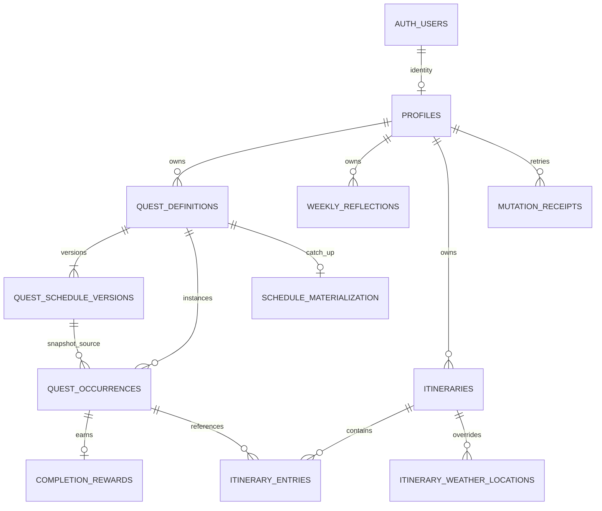

# PostgreSQL Database Structure Plan

**Updated:** 16 October 2026

**Status:** Calendar schema design baseline, with a foundation subset now represented by local migrations/tests described in [the webapp status](webapp/README.md). The complete pilot schema and remote deployment are not proven by this document. New assistant/knowledge models remain design-only; no SQL is executed by the present brainstorming pass.

**Related:** [RLS and permissions](RLS_PLAN.md), [technical design](TECHNICAL_DESIGN.md), [local sync](LOCAL_SYNC_DESIGN.md), [product plan](PRODUCT_PLAN.md), [creator extension](CREATOR_PLAN.md), and [workspace/AI](UI_UX_PLAN.md).

**API contracts:** [API_CONTRACTS.md](API_CONTRACTS.md) defines the proposed RPC envelopes, bigint-safe wire types, related revision guards, bounded snapshot/acknowledgment behavior, and provider/planning request boundaries. It adds no executable migrations or remote connection.

**Data architecture:** [DATA_ARCHITECTURE.md](DATA_ARCHITECTURE.md) explains conceptual ownership, intentional snapshots, consistency and lifecycle. This schema plan remains the source for exact fields/keys/constraints; adopting CUPID changes no table or wire identity.

**Expanded assistant model:** [Personalization](PERSONALIZATION_PLAN.md#8-data-architecture-and-contracts-to-design) and [second-brain architecture](SECOND_BRAIN_PLAN.md#3-authority-representations-and-links) propose private settings/memory/notes, source and People references, links and optional derived search chunks/vectors. The thirteen-table calendar pilot is not a complete assistant schema. Define ownership, revisions, source eligibility/deletion, bounded search and RLS/API contracts before adding migrations; conceptual links do not require a graph database. A portable Markdown file is not an authoritative calendar command or a credentials/settings import.

## 1. Recommended structure and rollout

Use **9 owner-readable application tables and 4 internal tables by pilot readiness**. The first foundation has the nine application tables and two sync reliability tables; add the two operating tables with the account/provider slices. Supabase Auth already supplies `auth.users`; do not create another credential/user table. Optional photo fields belong to itineraries. Creator publishing has a separate later migration set. Radio is parked; AI conversations/layout/mascots do not need database tables initially.

| Schema | Initial contents | Exposure |
| --- | --- | --- |
| `auth` | Supabase-managed identities | Managed by Supabase; no application access to password/token rows |
| `public` | Nine application tables and explicit API function wrappers | Authenticated owner reads through allowlisted RPCs; table SELECT supports invoker functions, direct table endpoints denied |
| `app_private` | Two sync and two operating tables, command implementations/helpers | Not listed in Data API exposed schemas; no client table grants |
| `storage` | Supabase-managed object catalog | Small service-only operations-recovery bucket before pilot; no calendar user uploads; private creator artwork buckets later |

Use `public` for the existing planned client read model with explicit grants/RLS, rather than adding a second API around every read. Put privileged implementations in the unexposed schema; the [RLS plan](RLS_PLAN.md) defines the public invoker wrappers and restricted executor. The schemas are namespaces, not separate databases.

The occurrence-to-itinerary relationship retains historical tombstoned memberships, but permits only one **active** membership per occurrence. No itinerary row owns a second event time, completion status, or reward.

## 2. Shared column conventions

- Entity IDs are UUIDs, generated before local enqueueing and preserved on acceptance. `profiles.id` is the Auth user UUID. Receipts use a compound owner/operation UUID key. Materialization uses a compound owner/definition key.
- `owner_id uuid NOT NULL` references `profiles.id`. Parent tables expose `UNIQUE (owner_id, id)`; composite child foreign keys preserve ownership. Client commands never select their owner; the database derives it from verified request identity.
- Mutable entities use `revision bigint NOT NULL DEFAULT 1 CHECK (revision > 0)`, plus server-assigned `created_at`/`updated_at timestamptz`. A successful entity change increments its revision. Owner, ID, and creation timestamp are immutable through ordinary commands.
- Deletable cached records retain `deleted_at timestamptz NULL`. Deletion changes revision; normal commands cannot revive a tombstone. Archive state and deletion are distinct. Retain tombstones/operation receipts for the MVP lifetime; account deletion is the deliberate hard-delete exception.
- Use `date` for local dates, `time without time zone` for wall times, IANA names as bounded `text`, and `timestamptz` for resolved instants. `timestamptz` alone does not preserve the originally selected zone.
- Prefer bounded `text` plus CHECK constraints for the small initial category/state vocabulary. No custom-category table or enum migration framework is needed. Fixed categories: `work`, `learning`, `health`, `personal`, `admin`; priority: `main`, `side`.
- Create defaults agree with the existing product: category `personal`, priority `side`, occurrence status `pending`, recurrence `none`, and new itinerary state `active`. Commands select context-specific `blocks_time` defaults; lodging/reference does not inherit a blocking stay by accident.
- Use normal columns for ownership, schedule, status, revisions, foreign keys, and indexed values. Reserve bounded validated JSONB for optional provider metadata/photo references and command results; do not store every entity as an unrestricted JSON document.

## 3. Core table contracts

### `public.profiles`

| Columns | Type / contract |
| --- | --- |
| `id` | UUID PK, FK to `auth.users(id)` with account deletion cascade |
| `display_name` | Bounded text, maximum 80 characters; not a public creator identity |
| `planning_timezone` | Nonempty valid IANA zone; confirmed on onboarding |
| `reduced_motion`, `show_streaks`, `celebrations_enabled` | Boolean preferences; proposed defaults false, false, true; system reduced motion also applies |
| `temperature_unit` | Text CHECK `celsius` / `fahrenheit` |
| `weather_home_label`, `weather_home_latitude`, `weather_home_longitude` | Nullable selected city label and paired double-precision coordinates; validated bounds |
| `revision`, `account_data_revision`, audit timestamps | Entity revision for preference edits; separate bigint account snapshot counter, initially 0 |
| `sync_epoch` | Server-minted UUID, immutable to user commands; reminted by the operator after a database restore before access |
| `deletion_requested_at` | Nullable server-only timestamp; ordinary mutations stop while account deletion is requested |

Do not copy passwords, Auth tokens, account email, writable XP/level, chat history, or mascot animation state here. Create the profile through an authenticated idempotent `ensure_profile` command after sign-in; no elaborate Auth-signup trigger is needed initially. Normal commands require that profile. Deletion removes the Auth identity through the authorized server workflow, not a browser DELETE on profiles.

### `public.quest_definitions`

`id uuid`, `owner_id uuid`, `state text` (`active` / `archived`), `revision`, audit fields, optional `archived_at`, and `deleted_at`. This is the stable identity for either a quest or appointment, despite the historical table name.

Archiving stops future scheduling while preserving history/rewards. Deleting a recurring definition uses the documented archive/tombstone behavior, not physical deletion of historical rows. Existing historical occurrences remain readable and can use permitted history operations; do not make them disappear through an overly broad parent-state filter.

### `public.quest_schedule_versions`

| Columns | Type / contract |
| --- | --- |
| `id`, `owner_id`, `definition_id` | UUIDs; composite owner/definition FK |
| `effective_from`, `effective_until` | Date interval `[from, until)`; nullable upper bound; positive, nonoverlapping versions per definition |
| `entry_kind`, `title`, `notes`, `category`, `priority`, `blocks_time` | Quest/appointment discriminator; nonblank title ≤200, notes ≤5,000; fixed vocabulary and boolean |
| `anchor_date`, `recurrence_kind`, `recurrence_weekdays`, `recurrence_until` | First schedule anchor; `none` / `daily` / `weekly`; ISO weekdays 1–7; optional inclusive final date |
| `timing_kind`, `planning_timezone` | `untimed` / `timed` / `all_day`; starting/date-context IANA zone |
| `start_local_time`, `end_local_time`, `end_local_date`, `end_timezone` | Nullable template endpoints; explicit end date/zone allowed for one-off appointments |
| `start_ambiguity_choice`, `end_ambiguity_choice` | Nullable text CHECK earlier/later; explicit booked-fold selection, null for routine policy/unambiguous or absent endpoints |
| `all_day_end_exclusive` | Nullable exclusive end date for all-day spans |
| `revision`, audit fields, `deleted_at` | Version interval changes are controlled and preserve historical snapshots |

Recurring entries initially stay within one local day/zone; derive the occurrence's local end date from its eligible date, rather than reusing the template anchor's end date. Multi-day/end-zone appointments are one-off. Require distinct valid selected weekdays only for weekly rules. Untimed rows have no invented time; all-day rows have no timed endpoints; timed rows have a start and either a validated end or explicitly unknown duration.

Enforce nonoverlap using a date-range exclusion constraint per definition, with `btree_gist` if available in the eventual environment. Check extension availability/version before migration authoring. Close/split an interval before inserting its successor. This prevents two competing future schedules for one definition without prohibiting ordinary event overlaps.

### `public.quest_occurrences`

| Columns | Type / contract |
| --- | --- |
| `id`, `owner_id`, `definition_id`, `schedule_version_id` | UUID identity and source links; version must belong to this same owner **and definition** |
| `original_scheduled_date`, `effective_date` | Immutable original occurrence anchor; editable effective local start/date after rescheduling |
| `entry_kind`, `title`, `notes`, `category`, `priority`, `blocks_time`, `timing_kind` | Snapshot of the version, with explicitly permitted occurrence overrides |
| `start_local_time`, `start_timezone`, `end_local_date`, `end_local_time`, `end_timezone`, `all_day_end_exclusive` | Labeled local endpoint snapshots; effective date supplies the starting local date |
| `start_ambiguity_choice`, `end_ambiguity_choice` | Preserved nullable earlier/later choices matching the validated endpoint resolution |
| `starts_at`, `ends_at`, `due_at` | Nullable validated UTC instants; computed/verified by the controlled operation, never trusted from input alone |
| `status` | `pending` / `completed` / `skipped`; overdue is derived, not stored |
| `completed_at`, `completion_timezone`, `completion_local_date`, `completion_accepted_at` | Validated user-observed instant/zone and server-derived local completion date, plus server acknowledgment time |
| `revision`, audit fields, `deleted_at` | Soft-delete and concurrency contract |

Require `UNIQUE (definition_id, original_scheduled_date)`, including tombstones. Derive UUIDv5 using [the fixed shared namespace, encoding and vectors](DEVELOPMENT_SETUP.md#5-shared-occurrence-identity); prove TypeScript/SQL parity during implementation. Rescheduling changes neither original identity nor original anchor.

Use a composite `(owner_id, definition_id, schedule_version_id)` FK to the corresponding unique version tuple; a same-owner version from another definition is still invalid. Completed rows need completion fields; undo clears the active completion fields. Preserve the timezone used for the action so a later profile-zone change does not reclassify historical consistency. Accept delayed actions without equating observed time to sync time; proposed future-clock tolerance is five minutes, with explicit correction on larger discrepancies. This is self-reported planning, not a competitive anti-cheat protocol.

Validate positive duration using resolved UTC endpoints, including date-line travel. Ordinary quests and repeating templates stay single-day. All-day boundaries are exclusive. An appointment's completed state means attended and grants zero XP. Editing a completed entry's kind requires undo first.

All-day quests require `all_day_end_exclusive = effective_date + 1` calendar day; derive `due_at` at the first valid local instant of that end date in the quest zone (earlier midnight fold, forward through a midnight gap). Keep their date-only/timed-anchor distinction; no assumed 24-hour planned duration. Booked timed appointments reject nonexistent clocks and require earlier/later for ambiguous endpoints. Routine gap/fold policy uses the shared technical rules. `unskip_occurrence` clears skipped state to pending under revision/source guards and never creates a reward.

### `public.completion_rewards`

`id uuid`, `owner_id uuid`, `occurrence_id uuid UNIQUE`, `awarded_xp integer CHECK > 0`, immutable `rule_version text`, original `awarded_at timestamptz`, optional `reversed_at`/`reactivated_at`, and revision/audit fields. Composite owner/occurrence FK required.

The database assigns **20 XP** under the initial rule. Undo/deleting the occurrence reverses its one reward; recompletion reactivates the same awarded amount/rule. Total XP is `SUM(awarded_xp)` over active rewards; level is `1 + floor(total / 100)`. Room milestones are derived from that level/static catalog, not a writable inventory or another balance table.

The occurrence/reward invariant spans tables: enforce it through transactional commands and a deferred constraint-trigger check, not a cross-table CHECK expression. At commit, a live completed quest has exactly one active reward; completed appointments and pending/skipped/deleted occurrences have none. Prevent deleting/reclassifying a reward independently of the occurrence transition. Attach checks to both affected tables and cover old/new affected identities; a normal update cannot skip the check. PostgreSQL supports end-of-transaction checks through [constraint triggers](https://www.postgresql.org/docs/current/sql-createtrigger.html).

The trigger must inspect the real pair even during authorized account cascades without an end-user JWT. Use an unexposed trigger implementation under a separate restricted invariant-reader role, limited to required occurrence/reward columns; it checks only the IDs/owners supplied by the trigger event and returns no data to a client. Missing both rows after account deletion is valid. Do not let caller RLS turn an existing reward into an apparent absence or block Auth cleanup; see the RLS role contract.

### `public.weekly_reflections`

`id uuid`, `owner_id uuid`, `week_start_date date`, `planning_timezone text`, nullable `takeaway text` and `next_action text` (≤500 each), revision/audit fields, `deleted_at`. Unique `(owner_id, week_start_date)`, including tombstones; require Monday and at least one nonblank field for a live reflection.

Clearing a reflection tombstones it. Writing that same week again is an explicit restore of the same logical row using its current revision, not an implicit upsert from a stale device. Reflection saves/restores never award XP.

## 4. Itinerary and weather tables

### `public.itineraries`

`id uuid`, `owner_id uuid`, `title text` (≤200), inclusive `start_date`/`end_date date`, `display_timezone text`, optional bounded `destination_summary`/`notes`, `state text` (`active` / `archived`), optional `archived_at`, revision/audit fields, and `deleted_at`. Require `end_date >= start_date`; upcoming/current/past is derived.

Selected base weather fields: nullable `weather_label text`, `weather_latitude`/`weather_longitude double precision`; same validation as profile home location. Changing the date envelope or display zone cannot move linked appointment instants.

Optional Pexels experiment adds `cover_mode text` (`auto` / `manual` / `none`), nullable bounded `cover_selection jsonb`, and `cover_context_revision bigint`. Validate the selection's exact provider hosts, IDs, attribution, dimensions, and variants at database/application boundaries. None mode clears the selection; manual mode requires one; auto may initially be empty. Use a versioned validator, not arbitrary remote URLs. These columns are added only when that experiment ships.

### `public.itinerary_entries`

`id uuid`, `owner_id uuid`, `itinerary_id uuid`, `occurrence_id uuid`, `logistics_kind text` (`transport`, `lodging`, `activity`, `meeting`, `buffer`, `preparation`, `other`), optional bounded `place_name`, `address`, `booking_reference`, HTTPS `booking_url`/`map_url`, and private `notes`; revision/audit fields and `deleted_at`.

Composite owner-matched FKs to itinerary and occurrence. Partial unique index on `occurrence_id WHERE deleted_at IS NULL` permits one active membership while retaining past detached records. A `preparation` membership may reference a quest before the trip; transport/lodging remain appointments unless the user explicitly chooses a quest for a real task. No independent schedule/status/XP columns or ordering column that pretends to change chronology.

The itinerary revision is an aggregate guard over trip metadata/membership/weather changes. Structural attach/detach also advances the linked occurrence revision to reject delayed stale membership intentions; return the new aggregate revisions atomically. Ordinary edits/completions of the shared occurrence use its own revision without bumping unrelated itinerary metadata. The API plan defines exact expected/related revision inputs; a counter token is not a replacement entity CAS revision.

Deleting/detaching an itinerary tombstones its metadata, preserving the occurrence/history. Deleting an occurrence tombstones all its active memberships in the same command. Creating an itinerary appointment inserts the normal calendar entities and its membership atomically. Tombstoning an itinerary also tombstones dated weather overrides.

### `public.itinerary_weather_locations`

`id uuid`, `owner_id uuid`, `itinerary_id uuid`, `itinerary_local_date date`, selected `location_label text`, `latitude`/`longitude double precision`, optional bounded provider location ID/region/country metadata, revision/audit fields, `deleted_at`. Composite itinerary ownership FK; unique active `(itinerary_id, itinerary_local_date)`.

Location choices may have a date outside a subsequently edited trip envelope; flag it in the UI rather than silently destroying it. Require paired finite coordinates within latitude −90..90 / longitude −180..180 and a bounded selected label. Explicitly reject nonfinite floating-point values. Do not add PostGIS/geocoding/place catalogs solely for these city selections.

WeatherAPI forecast payloads are **not** database records, receipts, exports, or backups. Preserve only selected user settings; follow [the weather expiry contract](WEATHER_PLAN.md). Pexels photos are references/credit, not Storage objects.

## 5. Internal reliability tables

### `app_private.mutation_receipts`

Compound PK `(owner_id uuid, operation_id uuid)`; `command_name text`, `command_schema_version integer`, `canonical_payload_hash text`, compact bounded `accepted_result jsonb`, and `accepted_at timestamptz`. Owner FK to profiles. Store acknowledgment IDs/revisions/outcome, not a second full private command body, prompt, secrets, or image bytes.

Insert the receipt claim and finish its outcome within the same transaction as the domain change. Serialize duplicate claims through the unique key. An identical retry returns its prior result before rechecking a now-stale revision; changed payload under the same operation ID fails. Failed commands roll back the claim. No permanently visible unfinished receipt or receipt pruning in the MVP. Read an own receipt only through a narrow authenticated RPC, never a client table grant.

Command responses may pair that original acknowledgment with current owner-scoped canonical rows/progression, read under the same owner lock and distinguished from the old receipt outcome. Do not store a full historical private snapshot just to replay a response. The local sender must have validated canonical data before removing its pending projection; an old acknowledgment cannot overwrite a newer row/reward state.

### `app_private.schedule_materialization`

Compound PK `(owner_id uuid, definition_id uuid)` and composite definition FK; `due_materialized_through date NULL`, `revision bigint`, audit fields. Track the contiguous historical catch-up boundary separately from future-window generation. A future window request does not advance the past cursor. Advance only after every eligible date in its bounded batch is processed transactionally; if catch-up is incomplete, report that coverage instead of hiding obligations.

These are two narrow reliability tables, not an incremental event bus or a second writable local database. Dexie snapshots, outbox commands, account partitions, and tab leases remain browser-side under [the sync contract](LOCAL_SYNC_DESIGN.md).

### `app_private.request_budgets` — before provider/account pilot gates

Fixed allowlisted `bucket_kind`, `subject_kind`, `subject_key` and `window_kind` (minute/hour/day/month), optional `owner_id` with Auth FK/cascade for account buckets, server `window_start`/`window_until`, nonnegative bigint `reserved_units`, and timestamps; unique bucket/subject/window-kind key, reused/reset for each current window. Global/provider/job buckets have no owner FK and no browser access. Limits/window durations come from trusted configuration, never request-selected reset values. No prompts, locations, notes or tokens. Account-scoped command helpers may access only their own fixed request buckets; the separate operations role handles provider/job reservations and maintenance. Ordinary SQL errors roll back request accounting; provider reservations commit before an upstream call. Budget changes never advance calendar snapshot counters.

### `app_private.account_deletion_jobs` — before account pilot gate

UUID job PK, immutable verified `owner_id` **without an Auth/profile FK**, status-secret digest, operation identity, reauthenticated/expiry timestamps, state (prepared/requested/running/completed/needs_help/expired), attempt count, next attempt, lease expiry, safe error code and timestamps. Unique owner/operation identity; no content/password/token storage. A job survives Auth deletion and cannot be rebound. Exact state/lease/retention and service-only prepare/confirm/status/runner behavior are in [OPERATIONS_PLAN.md](OPERATIONS_PLAN.md#3-retryable-account-deletion). Trusted operations also write small private Storage deletion markers before Auth removal; they are not owner-uploaded art or sync records.

The shared owner-FK, revision and tombstone conventions apply to domain/sync tables; these operating records follow the explicit exceptions above, are excluded from user exports, and use restricted service workflows rather than the ordinary outbox.

## 6. Constraints, indexes, snapshots, and deletion

| Concern | Database enforcement |
| --- | --- |
| Cross-owner parent links | Composite foreign keys and matching unique parent tuples; not RLS alone |
| Valid fields | NOT NULL, bounded text/CHECKs, coordinate/time validators, controlled command validation |
| Recurrence identity/history | Stable UUIDs, unique original date, nonoverlapping version intervals, tombstones |
| Rewards | Unique occurrence reward, protected writes, atomic command, deferred cross-table invariant |
| Concurrency | Expected entity revision and locks; do not replace a queued base revision with a newer pull |
| Repeat requests | Owner-scoped operation receipt and immutable canonical retry payload |
| Overlap | Advisory half-open interval checks; no exclusion constraint that forbids intentional event overlap |
| Multi-page sync | Account snapshot token and deterministic pages, never independent unversioned requests |

Initial indexes: occurrence `(owner_id, effective_date)`, timed start/end query indexes with owner prefix, definition/occurrence/version foreign-key indexes, definition/effective interval exclusion, active reward owner lookup, reflection owner/week uniqueness, itinerary owner/start date, membership `(owner_id, itinerary_id)` and active occurrence uniqueness, override itinerary/date uniqueness, and receipt/materialization compound keys. Do not duplicate indexes already supplied by PK/unique constraints; inspect real query plans before adding broad GIN or range indexes.

Every accepted change affecting a snapshot locks the owner's profile first and increments **`account_data_revision`** in the same transaction. This is separate from profile preference `revision`; another quest edit cannot create a false preference-edit conflict. Duplicate receipt replay/no-op does not advance the counter. Initial mutations serialize per owner, then lock definitions/occurrences/itineraries in a documented consistent order; different users remain independent.

A bounded scope pull returns the counter token, scope, deterministic cursor, rows, and coverage/tombstones. Each page uses one SQL snapshot that verifies the expected token and reads its rows. If a concurrent change advances the token, return `snapshot_changed` and restart the confirmed pull, retaining all local pending overlays. Complete a scope only after every page validates; never treat a partial response or an out-of-range moved entry as global deletion. Materialization happens before the read snapshot and invalidates tokens when it changes scoped data. This counter is not a new change-feed protocol.

RPC DTOs return bigint revisions/counters as decimal strings. Scope tokens also preserve the first-page `as_of` for time-derived summaries and have the API plan's expiry. `page_set_complete` does not imply historical/generation completeness. Materialization is an explicit write command, never a side effect hidden in pagination. Broader mutation responses can invalidate scopes when all affected rows cannot fit in a bounded canonical response.

Snapshots also bind `profiles.sync_epoch`. After restore, the operator reconciles independent deletion markers and remints each surviving account's epoch before opening access. Ordinary mutation envelopes carry the observed epoch; after receipt lookup, a missing receipt plus mismatched epoch rejects with `restore_requires_review`. Deletion-requested accounts reject new ordinary mutations. Client input cannot edit epoch/lifecycle fields. See [operational restore](OPERATIONS_PLAN.md#5-hosting-backups-and-operator-responsibilities).

Use `ON DELETE CASCADE` for the direct profile/Auth and user-owner relationships. For owner-matched domain FKs, prefer `NO ACTION DEFERRABLE INITIALLY DEFERRED`: ordinary parent hard deletion cannot erase history; full owner deletion can remove all rows before commit. Test the full graph rather than assuming cascade order. Browser/executor grants permit no physical DELETE; ordinary commands tombstone. Account deletion retains recovery/cleanup state until the authorized workflow succeeds.

PostgreSQL distinguishes row-local CHECK constraints from cross-row/foreign-key enforcement; use the correct mechanism for each invariant. See [constraint documentation](https://www.postgresql.org/docs/current/ddl-constraints.html).

## 7. Creator publishing — later migration set

Keep creator base tables in **`app_private`**, with owner RLS and explicit owner/public read RPCs. Public readers receive an allowlisted DTO, never a SELECT grant over a draft table. Separate original creator art from optional stock itinerary imagery.

| Future table | Shape and constraints |
| --- | --- |
| `creator_profiles` | Owner UUID, unique public slug, pen name and chosen public bio; private Auth/profile remains separate |
| `content_series` | Owner, slug/title/description, visibility, reading format/direction, weekday/time/IANA zone cadence, revision/tombstone |
| `content_chapters` | Owner/series, stable chapter UUID, unique series ordering key/slug, state, current version and optional published-version reference, revision/tombstone |
| `chapter_versions` | Owner/series/chapter, UUID plus unique chapter/version number, frozen title/summary/mode/external URL, readiness; immutable after scheduling/publication |
| `chapter_pages` | Owner/chapter/version, unique position, immutable private object references, verified bytes/MIME/dimensions, asset readiness and transcript/description |
| `release_slots` | Owner/series, local target date/time/zone and `scheduled_at timestamptz`, optional owner/series-matched chapter/version assignment, announcement flag, state/revision |
| `publication_events` | Owner/chapter/version/slot, accepted target/actual timestamp and outcome; unique publication per accepted assignment, immutable audit |
| `creator_quest_links` | Private owner/series/chapter reference to existing owner-matched calendar occurrence; no duplicated completion/rewards |

`chapter_versions` makes the earlier content-version field concrete: a release freezes an actual immutable metadata/page manifest, including an external URL, rather than pointing at a mutable draft. Add its FKs after stable parent tables exist; validate that current/published versions belong to the same chapter. Scheduled slots accept only ready versions, with one active assignment per chapter/slot. Worker publication and owner cancel/withdraw share the same lock order, including the owner snapshot counter when creator snapshots are added.

Public eligibility requires a live publicly visible series, a live published chapter, its accepted published version, and actual publication time not later than database time. Optional upcoming announcements expose only opted-in slot timestamps, not private assigned titles/pages/URLs. Original/private/scheduled Storage assets remain inaccessible to anonymous direct requests; the media service checks publication before signing short-lived URLs. Full policies and system-role separation are in [RLS_PLAN.md](RLS_PLAN.md).

## 8. Features that do not need tables now

No separate appointment table, writable XP/level/room inventory, mascot/chat memory, persistent AI proposals, full radio catalog/listening history, weather archive, image binaries, multiplayer membership, external-calendar tokens, maps/routes, file-path attachments, or notifications table in the initial schema. Add later feature tables only when their persistence contract is implemented. AI-accepted edits use the same normal entities/commands.

## 9. Planned migration sequence and stop gate

1. Review this plan and the RLS permission matrix; settle the documented defaults.
2. After the user authorizes implementation, create versioned migrations in a **disposable local Supabase environment**: schema/grant defaults, restricted executor, profiles, core entities/constraints, internal tables, read policies, command functions, indexes, and snapshot contract.
3. Add itinerary/weather settings as their feature slice arrives; optional cover columns only with that experiment. Generate TypeScript types from the resulting schema.
4. Run the [RLS/command tests](RLS_PLAN.md#8-verification-matrix) and domain/date/retry/sync tests locally, including a fresh migration application and account-deletion graph. Inspect performance for representative scopes.
   Add private budgets/deletion jobs, profile epoch/lifecycle guards, operations marker bucket and service-only functions as their slices arrive; prove the complete thirteen-table pilot boundary locally.
5. Present the migrations/results before choosing/linking a remote project and applying anything there. A future authorization to implement must establish its intended environment; this request does not authorize connection or execution.
6. Creator tables/buckets/worker roles and parked radio remain separate migrations/gates.

**Current stop condition:** Documents are consistent, links/relationships checked, and the access model is reviewable. No SQL has run and no RLS test is claimed to pass until executable migrations exist.
