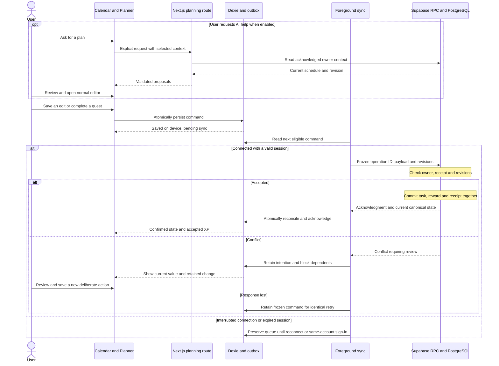

# Gamecal Documentation Review

**Reviewed:** 14 October 2026

**Scope:** Original review of all 15 existing root Markdown documents, followed by the planning-resolution pass below. The original findings are retained as history. The resolution pass updates the relevant baseline documents; it authorizes no implementation, provider setup, Supabase connection, purchase or SQL execution.

**Current assessment:** The six gap groups raised in chat have planning resolutions in the baseline documents and [OPERATIONS_PLAN.md](OPERATIONS_PLAN.md). The [webapp foundation](webapp/README.md) now provides tooling, typed helpers, Auth-only factories and account metadata storage. The CLI and local configuration exist; the container runtime, SQL/RLS, product Auth/sync flows and operating contracts remain unproven. Existing documents remain uncommitted; no remote project or deployment is configured.

## Resolution register

| Original finding | Planning status | Resolution / remaining proof |
| --- | --- | --- |
| D-01 recovery export/sign-out | Resolved in plan | Export never purges work; Keep work and sign out retains a locked same-account queue; actual lifecycle/isolation tests pending |
| D-02 accidental Skip | Resolved in plan | `unskip_occurrence`, skipped -> pending, zero XP; ordered retry/revision and visible Undo skip proof pending |
| D-03 time precision | Resolved in plan | All-day due rule, earlier/later endpoint fields, routine DST policy, profile display-only update plus reviewed per-series future changes; SQL/client parity proof pending |
| D-04 AI launch scope | Resolved in plan | Live AI optional for calendar pilot; split shell/guidance required; model selection/AI quality/cost gate remains separate |
| D-05 local/remote order | Resolved in plan | Disposable local migrations/Auth/RLS/vertical slice and review before separately authorized remote project linking/application |
| D-07 request/cost controls | Resolved design, deployment gate | Shared PostgreSQL budgets, numeric defaults, Data API endpoint allowlist, separate committed provider reservations; transactional failed-attempt limitation documented; real ingress/cap/concurrency checks pending |
| D-08 deletion recovery | Resolved design, implementation gate | Fresh prepare/confirm, independent private job, restricted status capability, retry runner, operator deletion markers and verified absence before local clear; no job/API exists yet |
| D-09 cache cleanup | Resolved design, implementation gate | Bounded confirmed-cache target/LRU, pinned queue dependencies, cleanup/retry without reset; browser/tab/quota proof pending |
| D-10 operating readiness | Defined baseline, pilot gate | Proposed hosting/backups, operator responsibility, restore epoch/journal safety, device/support/SMTP/configuration checklist; actual provisioning, selected email provider/reference phone and restore measurements remain outstanding |
| D-06 development setup | Scaffold verified; local database stage pending | [Setup guide](DEVELOPMENT_SETUP.md) and [webapp record](webapp/README.md#verification-recorded-on-16-october-2026) cover compatible pinned dependencies, strict checks, TypeScript UUID/date fixtures, 53 passing unit checks, production build and one browser smoke test; containers, SQL parity, captured Auth flows and remote CI remain unproven |

Small reward-wording and HTTPS-link inconsistencies are corrected. The documentation index is now [README.md](README.md). The 16 October design update adds [CUPID](ARCHITECTURE_PRINCIPLES.md) and [data architecture](DATA_ARCHITECTURE.md), with references in the coding/technical/schema/product guides. Archive restoration remains a separate follow-up choice. The tables below describe the original gaps as found, not their current implementation status.

## 1. Findings before the affected feature is implemented

| ID | Priority | Gap and consequence | Recommended resolution | Evidence |
| --- | --- | --- | --- | --- |
| D-01 | High | Sign-out can clear unsynced commands after the user saves a recovery bundle, but import/restore is deferred. The file preserves information without providing a supported return path into the app. | Keep pending commands in a locked, account-isolated partition on sign-out, or require sync/explicit discard until a reviewed restore flow exists. Explain that an export alone cannot restore unsent work in the MVP. Confirm the chosen lifecycle policy before changing the baseline. | [Sync lifecycle](LOCAL_SYNC_DESIGN.md#7-account-lifecycle-exports-and-storage-limits), [first-session sign-out](FIRST_SESSION_PLAN.md#6-loading-sync-and-recovery-copy), [account APIs](API_CONTRACTS.md#10-account-and-later-creator-interfaces) |
| D-02 | High | Skip is a terminal ordinary workflow: complete and reschedule accept pending entries, while Undo accepts completed entries. A mistaken skip has no documented return to pending. | Specify a revision-checked `unskip_occurrence` transition from skipped to pending, retaining identity and awarding zero XP. Include local queue ordering, stale/conflict recovery, and a visible Undo skip action. | [Command catalog](API_CONTRACTS.md#4-calendar-and-profile-rpc-catalog), [status and recovery](PRODUCT_PLAN.md#c-status-and-recovery) |
| D-03 | Medium | Timed and untimed overdue rules are defined, but all-day quest due-time derivation is not. Booked appointments require an explicit DST ambiguity choice without exact request fields. Future routine timezone changes are promised without a concrete UI-to-command mapping. | Define all-day quest eligibility/due time at the next local midnight under the single-day rule. Define validated start/end ambiguity-choice fields and UTC round-trip examples. Use deliberate per-series `edit_series` commands for future routine changes initially; distinguish preserving the wall clock from preserving an instant. | [Time semantics](TECHNICAL_DESIGN.md#8-recurrence-and-time-semantics), [timing inputs](API_CONTRACTS.md#4-calendar-and-profile-rpc-catalog), [occurrence columns](DATABASE_SCHEMA_PLAN.md#publicquest_occurrences), [product timezone promise](PRODUCT_PLAN.md#8-recommended-architecture) |
| D-04 | Medium | The initial release scope includes real AI planning, while the UX/first-session plans allow a shipped deterministic guidance panel. It is unclear whether AI must pass before the calendar pilot can launch. | Publish one required/optional/deferred release matrix. Recommended: the calendar pilot can launch with honest guidance; live AI is enabled only after its own provider, quality, cost, and privacy gates pass. Preserve the planned itinerary/weather gates unless scope is deliberately revised. | [Phase 1A scope](PRODUCT_PLAN.md#5-release-scope), [delivery gates](PRODUCT_PLAN.md#10-delivery-plan-and-exit-gates), [workspace delivery](UI_UX_PLAN.md#7-delivery-and-verification), [first slice](FIRST_SESSION_PLAN.md#1-outcome-and-bounded-first-slice) |
| D-05 | Medium | The technical delivery list provisions/selects a Supabase project before migration work, whereas the database plan requires disposable local proof before choosing/linking a remote project. This gives implementers conflicting sequencing. | Align the sequence: development setup, disposable local migrations/Auth/RLS tests, first vertical slice, review of results, then separately authorized remote provisioning/linking/application. | [Technical implementation order](TECHNICAL_DESIGN.md#12-implementation-order-and-unresolved-setup), [database migration sequence](DATABASE_SCHEMA_PLAN.md#9-planned-migration-sequence-and-stop-gate) |
| D-06 | Medium | The next development-setup checklist has been requested by the plans but does not exist. Key reproducibility decisions remain open. | Add a bounded setup document with supported runtime/package versions, one package manager, local Supabase/SMTP configuration, environment placeholders, migration/fixture order, UUID namespace/encoding, timezone library, and runnable check commands. Establish CI when executable code exists. | [Next first-session plan](FIRST_SESSION_PLAN.md#8-delivery-order-and-stop-condition), [technical setup choices](TECHNICAL_DESIGN.md#12-implementation-order-and-unresolved-setup), [occurrence identity](DATABASE_SCHEMA_PLAN.md#publicquest_occurrences) |

Priorities concern planning decisions and user recovery; they are not claims of deployed vulnerabilities. Deliberately deferred features are not missing MVP implementations.

## 2. Decisions required before an invited pilot

| ID | Gap | Required decision/proof | Evidence |
| --- | --- | --- | --- |
| D-07 | Rate limiting and provider budgets are requirements without selected mechanisms or numeric budgets. Ordinary commands call Supabase directly, so Next.js limits alone cannot cover them. | Select enforcement at the Data API/command boundary and separate provider-route enforcement. Define per-account limits, a shared provider budget, reset/backoff behavior, operational alerts, and a manual disable path. Keep retries safe under throttling. | [RLS request controls](RLS_PLAN.md#4-read-rpcs-snapshots-and-views), [weather cost control](WEATHER_PLAN.md#5-caching-and-cost-control), [photo cost control](PHOTO_PLAN.md#4-integration-and-storage), [AI budget](API_CONTRACTS.md#9-planning-assistant-request-and-proposal-contract) |
| D-08 | Account deletion intentionally leaves its exact reauthentication and ambiguous-result recovery contract unresolved. A receipt that cascades with a deleted profile cannot prove removal later. | Define the action inputs, identity checks, fresh reauthentication, sender coordination, backend status/retry evidence independent of the removed account, and local-clear condition. Test a lost response after successful deletion. | [Account interface](API_CONTRACTS.md#10-account-and-later-creator-interfaces), [deletion operations](TECHNICAL_DESIGN.md#10-environment-and-deployment) |
| D-09 | Quota/write failures preserve drafts, but there is no concrete cache eviction or user recovery workflow for a full browser database. | Bound confirmed-cache retention and define safe cleanup that preserves pending commands. Show practical recovery options and pending-work warnings. Verify cleanup, reload, migration failure, and storage denial on the supported browsers. | [Local stores](LOCAL_SYNC_DESIGN.md#3-local-stores-and-atomic-save), [storage limits](LOCAL_SYNC_DESIGN.md#7-account-lifecycle-exports-and-storage-limits), [first-session recovery](FIRST_SESSION_PLAN.md#6-loading-sync-and-recovery-copy) |
| D-10 | Hosting, production Auth email delivery, backups/restore ownership, reference device/network, and performance measurements are still choices rather than an operating plan. | Establish the pilot environment, SMTP/delivery checks, backup retention and responsible operator, isolated restore rehearsal, browser/device matrix, monitoring, and a measured usable-agenda load target. | [Environment/deployment](TECHNICAL_DESIGN.md#10-environment-and-deployment), [performance target](TECHNICAL_DESIGN.md#9-ui-accessibility-and-performance), [email setup](FIRST_SESSION_PLAN.md#3-authentication-and-setup-details) |

Supabase's official [Data API security guide](https://supabase.com/docs/guides/api/securing-your-api) treats request controls separately from grants/RLS and describes Data API pre-request checks. Such a hook does not also cover Auth or Storage. Browser storage can reach quota or be evicted; [MDN's storage guidance](https://developer.mozilla.org/en-US/docs/Web/API/Storage_API/Storage_quotas_and_eviction_criteria) supports the need for tested recovery rather than a permanent local-storage guarantee.

## 3. Smaller consistency and maintenance fixes

- **Reward wording:** Product core-loop step 3 says immediate XP feedback, while the detailed product and sync contracts wait for server acceptance. Change that summary to immediate local checkmark feedback followed by accepted XP. See [core loop](PRODUCT_PLAN.md#4-core-loop) and [progression](PRODUCT_PLAN.md#d-progression-rules).
- **External links:** The itinerary plan accepts HTTP(S), while schema/API contracts require HTTPS. Choose one policy; recommend HTTPS for new booking/map links and align the editor, canonical validator, and tests. See [itinerary privacy](ITINERARY_PLAN.md#7-cached-access-and-privacy) and [membership columns](DATABASE_SCHEMA_PLAN.md#publicitinerary_entries).
- **Archive recovery:** Series/itinerary archive is defined without an explicit unarchive command. Decide whether restoring an archived itinerary/series is offered, and distinguish it from restoring a deleted record. This can follow the first one-off slice but should be settled before archive controls ship.
- **Documentation ownership:** Add a short index identifying product scope, API wire contracts, database constraints, RLS grants, sync lifecycle, and screen behavior as their respective sources of truth. Keep summaries short so later changes do not require duplicating entire contracts across many files. The agent guide is a coding baseline; feature details belong in the linked plans.

## 4. Extensions reviewed and deliberately deferred

| Area | Assessment | Decision before enabling it |
| --- | --- | --- |
| WeatherAPI | Clear nonblocking location/date, secret, freshness, and unavailable-state contracts | Real entitlements/key, numeric usage budget, route validation, and observed cache/expiry behavior |
| Pexels | Clearly optional; stable metadata-only cover choice, credit, query privacy, and fallback | Actual curated assets, measured transfer cost, request budget, and invalidation behavior |
| Creator/manga | Correctly separate from the calendar pilot; hosted/external releases, frozen versions, backend timing, private assets, and reader controls are planned | Exact publication/upload/media APIs, cleanup jobs, operator/report workflow, real art/quotas, and release monitoring before the creator pilot |
| Radio | Explicitly parked, with unverified provider quotas recorded rather than advertised as guaranteed free service | Verify the provider/stream contract and device playback when the user activates the feature |
| Maps, local file attachments, sharing, push, multiplayer | Deferred persistence and integration choices are explicit | Dedicated feature/provider/permission contracts when those slices are selected |
| Optional 3D | Has lazy loading, illustrated fallback, reduced-motion and renderer cleanup requirements | Actual assets, reference-device measurements, and demonstrated responsiveness |

The [WeatherAPI pricing page](https://www.weatherapi.com/pricing.aspx) still lists 100,000 monthly free calls and a three-day forecast. Its [terms](https://www.weatherapi.com/terms.aspx) still limit forecast caching to 24 hours. [Pexels' default-limit FAQ](https://help.pexels.com/hc/en-us/articles/47677890260761-Is-the-Pexels-API-free-to-use) still lists 200 requests/hour and 20,000/month; its separate [increase-request FAQ](https://help.pexels.com/hc/en-us/articles/900005852323-How-do-I-get-unlimited-requests) currently says increases are paused. Those baseline provider statements did not need a correction in this review. Real account entitlements must still be checked before enabling integrations.

## 5. Planned save, AI review, and sync sequence

This begins after verified sign-in/profile setup. It depicts intended behavior, not an implemented system. The foreground sender runs while the authenticated app is open; the diagram does not promise offline startup or browser-closed sync.

Weather/Pexels retrieval uses separate Next.js reads and never blocks this save path. Itinerary edits use the same occurrence and outbox. Undo follows the same accepted transaction path and reverses the corresponding reward.

## 6. Verification performed

**Resolution pass:** Local links/anchors, code fences, JSON examples and the thirteen-table schema/RLS correspondence are checked again after the planning updates. These are documentation checks; none prove the planned application/security behavior.

- Read all 15 existing planning/guide files and compared product, API, database, RLS, sync, and screen contracts.
- Checked 148 existing local Markdown links/anchors, code-fence pairing, and trailing whitespace: no structural issues found.
- Rechecked the official provider and platform references cited above; no credentials or authenticated integration calls were used.
- Confirmed there is no `package.json` or SQL file. No build, database, RLS, browser, or application test is claimed to pass.

**16 October setup pass:** The setup guide is written. Checked all 21 Markdown documents for local links/anchors, paired fences and trailing whitespace, plus both JSON examples, thirteen matching schema/RLS table names and three UUID reference vectors. No structural issues found. Runtime/package metadata was inspected read-only; no application dependencies or local stack were installed.

**Scaffold verification:** The user authorized the `webapp` foundation without product UI/UX. Strict/typed lint and compiler checks, 53 unit tests, production build and one Chromium smoke test pass locally. No SQL migration/RLS or integrated Auth/sync test has run; no remote project is linked. The local CI workflow has not run on GitHub.

**Recommended next work:** Make the local container runtime available and implement/prove the SQL/RLS/Auth foundation, then the first one-off quest/reconciliation slice. Keep live AI and later creator/radio gates explicit; no remote connection/table execution is implied by the scaffold.
