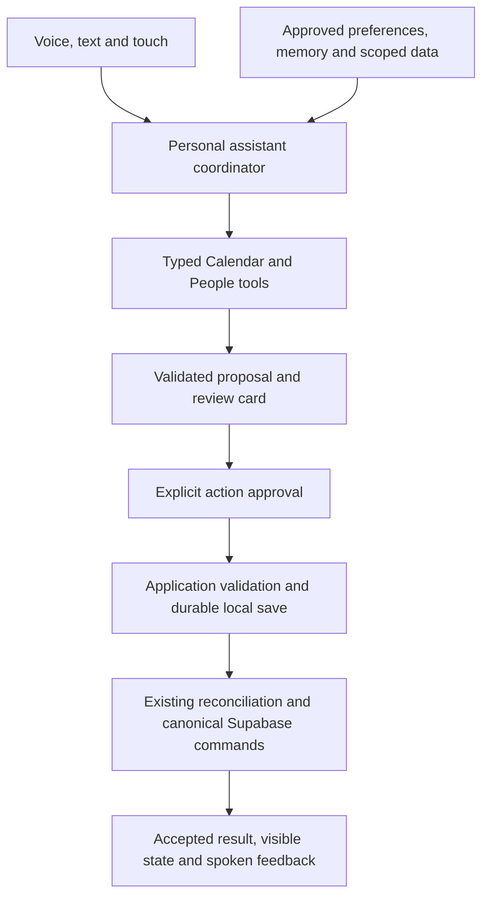

# Personal AI, Voice and Relationship Planning

**Updated:** 16 October 2026

**Status:** Product-direction and architecture proposal following review of commits `35b6a5b` and `6a160ed`. No assistant, voice session, memory store, social integration or product screen is implemented by this document. Existing calendar persistence, authorization and typed-contract work remains useful.

**Personalization extension:** [PERSONALIZATION_PLAN.md](PERSONALIZATION_PLAN.md) develops the user's hybrid idea: natural-language charter, persona presets, typed planning rules, capability-specific permissions, explicit teaching and later portable templates. It owns those proposed behavior/UX contracts. Passive observation, standing autonomous work and a public marketplace remain later, separately validated scope.

**Second-brain exploration:** [SECOND_BRAIN_PLAN.md](SECOND_BRAIN_PLAN.md) proposes explicit voice-note capture, Markdown knowledge, automatic organization/linking and cited recall through a cute-monster companion. The user confirmed that manual linking should not be required. Routine generated connections are applied automatically; consequential ambiguity gets selective clarification. Notes complement typed schedules and approved memory; embeddings are an optional derived index. A person-note/export template and a bounded delivery sequence are included. This does not finalize a new pilot scope or authorize autonomous cancellation, unsolicited private briefings, filesystem sync or agent-to-agent access.

## 1. Confirmed direction and scope still to decide

The user wants personal AI as the main feature, with calendar and social as capabilities of that assistant. Users should shape the assistant through their own information and instructions. Voice should be the primary input; the main screen should provide more than a chat conversation. Social initially means **keeping in touch and planning with people**, as clarified by the user.

Recommended product promise: **Help me make time for what matters and the people who matter.** Keep Gamecal as the working name until naming is revisited.

This supersedes the earlier framing of AI as an optional calendar add-on and voice as out of scope. The exact first AI-pilot scope, home layout, mascot treatment, provider and model below are proposals. The existing calendar-only pilot and compulsory 50/50 opening screen are historical release/layout baselines, not the finalized AI-first release plan. Calendar domain rules still apply whenever that capability ships.

## 2. One assistant, concrete capabilities

Use one coherent personal assistant with shared preferences, approved memory and permission handling. Calendar and People are domain capabilities exposed through typed tools. They are not separate assistants that each invent their own memory or own copies of calendar facts. A multi-agent framework is unnecessary for this starting scope.

| Capability | First useful behavior | Authority and limits |
| --- | --- | --- |
| Calendar | Summarize known commitments, suggest manageable tasks, propose time blocks or a catch-up | Canonical calendar/scope/revision rules; incomplete or external availability stays unknown |
| People | Maintain a small private list of people, optional user-entered notes and chosen contact intentions; suggest a catch-up | User-owned relationship notes, not verified knowledge about another person's availability |
| Personalization | Remember explicit planning preferences and communication style | User-editable preferences and approved facts; never grants additional tool permissions |
| Knowledge, proposed | Capture explicit voice/text notes, automatically organize/link them and retrieve cited context | Private source notes, attributed generated connections, selective clarification and source revisions; extracted actions require their own supported authorization |
| Voice | Listen after deliberate activation, clarify intent, speak brief responses and show actionable cards | Same validated intent/proposal/action path as text or touch |

Begin People with manual entry for a few important people, optional last-contact information and user-chosen reminders. No contact import, message inbox access, shared availability or external sending is required to validate this idea. A draft message can be copied by the user; external sending needs a later integration and a distinct authorization contract.

Do not infer that a suggested time works for someone else. Say it fits the user's known Gamecal schedule and can be offered to the other person. Declining contact suggestions should not cause guilt, relationship scores or lost rewards. Conversations, message volume and memory additions do not earn XP. The room/progression system becomes optional supporting presentation; real chosen quests retain their existing reward rules.

## 3. Personalization that the user can inspect

| Layer | Example | Recommended storage/control |
| --- | --- | --- |
| Instructions and tone | “Be concise. Help me avoid overplanning.” | Versioned, editable assistant settings; defaults resettable |
| Structured preferences | “Prefer afternoons for personal plans.” | Validated planning defaults with explicit timezone/meaning; suggestions can explain their source |
| Approved memory | “Alex usually prefers a Friday catch-up.” | Source, owner, creation/update time and optional review/expiry; edit, forget and exclude controls |
| Reference material, later | User-selected notes or documents | Explicit ingestion scope, source provenance, retention/deletion and bounded retrieval before using content |

This is application personalization through instructions, memory and selected context. It does not require training a separate model for every user. Start with explicit preferences and short notes; add file ingestion or vector retrieval only when actual retrieval needs justify the extra storage/pipeline.

[The proposed second brain](SECOND_BRAIN_PLAN.md) gives those short notes a usable capture/search/source lifecycle before adding whole-vault ingestion. A stored note is not automatically a durable instruction or an approved fact about another person. Explicit note capture, ordinary conversation and reusable memory have separate retention and promotion rules.

The [hybrid personalization plan](PERSONALIZATION_PLAN.md#1-product-model) separates expressive personality/charter from enforceable planning rules and action permissions. A free-text charter can propose a setting; accepted structured values own hard constraints. Corrections offer a one-time change or an explicit reusable lesson, and presets never change permissions or copy private memories.

An explicit “Remember that I prefer afternoons” can save the stated preference. An inferred preference should first appear as a memory suggestion. Ordinary conversation is not automatically permanent memory. Distinguish a user preference from an inference and a note about another person. A preference cannot silently move an appointment or override another person's choices.

Treat uploaded/reference content as data, even if it contains instructions. It cannot change account ownership, tool scopes, budgets or approval rules. Retrieve only context needed for the current request; do not send the entire account or all relationship notes into each model session.

Define source deletion and memory dependencies before ingestion ships: deleting a source removes its retrievable content and invalidates/reviews derived memories as appropriate. “Forget” must explain the app records removed; provider processing/retention must be checked separately before enabling a provider. Do not imply that deletion trains or untrains model weights.

## 4. A workspace organized around outcomes

Recommended default home: **Today**, an adaptive canvas with these elements:

- A short briefing and next commitment, with calendar coverage and sync status visible.
- A small assistant/companion area with clear idle, listening, thinking, speaking and unavailable states.
- A prominent tap-to-speak/stop control, mute/interrupt controls, and a compact optional transcript/text fallback.
- Action cards for proposed plans, unresolved questions and changes waiting for review.
- People cards for user-chosen intentions such as “Find time for Alex,” with snooze/dismiss controls.
- Direct access to Calendar, People and “What I remember,” so ordinary work remains possible without a voice conversation.

Spoken responses should be brief. Dates, names, before/after changes and save state belong in readable cards. A spoken request can bring the calendar into focus, but should preserve the user's current selection/draft and avoid surprising navigation. Conversation history can be a secondary drawer rather than the home page.

Keep voice primary while supporting touch, text, keyboard and readable outcomes in quiet/public environments or when speech/microphone access is unavailable. Start listening only after deliberate activation; do not promise an always-listening or browser-background assistant. End/mute indicators must reflect actual capture/connection state, with microphone tracks and audio playback cleaned up on exit or account change.

The existing twins may represent Calendar and People capabilities within one shared assistant experience. Whether to keep both, use one companion, or keep the fantasy room as a background element is still open. Recommend a lightweight 2D/static foundation and optional animation/3D later. The former mandatory split view can become an optional focused layout if useful; it should not constrain the new home concept.

## 5. Example first experience

1. User: “Remember that I prefer afternoons for personal plans.”
2. Assistant shows the explicit preference it saved and an Edit/Forget action, after accepted persistence.
3. User: “Help me find time to catch up with Alex this week.”
4. Assistant reads the user's acknowledged calendar window, relevant approved preference and the user-owned Alex note. Missing coverage or pending edits are stated rather than treated as free time.
5. Assistant: “You have Thursday afternoon open in Gamecal. I don't have Alex's availability.” A proposed catch-up card shows the actual date, duration and timezone.
6. User corrects the name/time if necessary and deliberately approves the specific card. A voice approval must bind to the current proposal/version; an unrelated “yes” cannot approve a different action.
7. The normal application operation validates and persists/enqueues the change. The UI distinguishes saved locally, awaiting sync and accepted; the assistant claims confirmation only after the corresponding result.

This is a target journey, not an implemented capability. Timed scheduling is currently deliberately restricted by the SQL foundation; proposing/saving real time blocks requires the corresponding validated timed-command slice. The assistant must not work around that restriction by saving incomplete events.

## 6. Architecture and reuse

Keep Next.js, React, TypeScript, Zod, Supabase and Dexie. Add a bounded assistant coordinator in the modular monolith, a context builder, a small tool registry and a voice adapter when implementing the chosen vertical slice. Keep business logic and tool execution independent of the model/voice transport. This does not require a general plugin marketplace, separate server per capability, or model-generated SQL.

Read-only tool calls may access allowlisted, authenticated scope reads. Model proposals remain untrusted: validate arguments, source revisions, account scope and action permissions outside the model. Approved durable calendar actions use the established local queue/canonical command path. A model/provider tool-call ID is not automatically a durable operation ID; create/freeze application IDs once for the approved intention, preserving them on uncertain retries.

Use canonical state for initial model planning; unresolved relevant pending changes must prevent availability claims or be explicitly handled by a later tested projection-aware context contract. Session cancellation stops audio/generation; it does not undo a command already durably accepted. Session/account changes isolate drafts, context and approved memory.

New assistant preferences, memory, sources, private people/interaction notes and proposal/run metadata need their own bounded ownership/RLS/retention design before migrations. Reuse existing profile preferences and occurrence references where they already express the fact; do not store a second schedule inside assistant memory. The thirteen-table calendar pilot model is not a complete schema for the expanded AI product.

## 7. Voice implementation candidate

A browser WebRTC voice connection, initialized by an authenticated server endpoint, is a suitable candidate. OpenAI documents server-mediated setup and short-lived client credentials, keeping the project API key server-side. This is research guidance, not provider/model selection or a purchased integration. See [official WebRTC voice guidance](https://developers.openai.com/api/docs/guides/voice-webrtc).

Next.js can own bounded authentication/context/session-setup requests while browser media connects to the voice provider. Do not assume a long-lived voice server can be hosted inside an ordinary request handler. A persistent control connection or worker should be added only if the selected provider's trusted tool/budget controls require it.

An explicit start/stop interaction is enough for the first prototype. Natural turn detection and interruption can follow; OpenAI's [VAD guide](https://developers.openai.com/api/docs/guides/realtime-vad) describes supported modes. Evaluate names, accents, noisy rooms, interruptions and corrected dates on actual target browsers. Browser microphone permission and HTTPS/localhost are prerequisites documented by the provider.

Before enabling real sessions, choose the provider/model/voice and verify terms, retention, access, current pricing and server-verifiable usage. Set bounded context, per-session duration/output and per-account/global spend reservations, plus cancellation/retry behavior. Existing text-generation budgets do not establish voice spend limits. A browser-only timer is not an enforceable provider cost cap. Do not store raw audio by default in the app; transcript persistence is a separate explicit choice.

## 8. Recommended first pilot and build sequence

The AI-first pilot must include a working assistant/voice path. An optional-AI calendar pilot is no longer sufficient validation of this product direction. Manual calendar/people controls remain a fallback when the service is unavailable. Recommended scope is one assistant, explicit preferences, a few manually entered people and a reviewed calendar proposal. Broad social integrations, autonomous sending, a feed, publishing, radio and advanced imagery remain later work.

1. Fix the newly reviewed pagination and zero-counter validation bugs and add regression tests. Finish entity-specific DTO/command schemas and consistent error handling before trusting AI context or actions.
2. Prove verified account/session handling and the minimum timed-calendar/persistence/reconciliation path needed by the example journey. Keep standalone capability operations usable from tests without AI.
3. Specify the first assistant preferences/memory/people model, owner isolation, forget/export/deletion behavior, proposal state machine and tool permissions. Decide which data is device-only versus synced; preserve the existing local-save lifecycle for calendar data.
4. In parallel with that implementation sequence, a bounded provider evaluation can test voice latency/cost using synthetic data once integration is explicitly selected. It cannot validate calendar correctness or replace the acceptance gate above.
5. Deliver one working voice -> scoped context -> proposal card -> explicit approval -> durable save -> accepted feedback journey. Include manual correction of a name/date and memory editing/forgetting.
6. Validate usefulness with a small invited group: successful intended actions, corrections, time to a reviewed plan, repeat voluntary use, memory accuracy/control and useful relationship follow-through. Measure latency and voice cost separately. Conversation length, time in app or contact frequency alone are not success measures.

## 9. Remaining product choices

- Exact AI-pilot calendar scope, including whether the first voice flow only proposes time blocks or also saves them.
- The home canvas density, companion/twin treatment and placement of the fantasy room.
- Memory defaults, source ingestion formats, expiry/review and transcript retention.
- Exact first rule kinds and charter/preset controls in [the personalization plan](PERSONALIZATION_PLAN.md#9-delivery-and-acceptance); no global full-autonomy toggle for the first pilot.
- The first provider/model and whether an SDK adds useful lifecycle handling over its direct client.
- Supported voice languages, a reference phone/browser/network and explicit latency/cost targets.
- Reminder execution: a visible in-app intention is not a guaranteed alert while the browser is closed; scheduling/push needs its own supported lifecycle.

Confirmed product direction is recorded above. These choices do not authorize new providers, external messages, production hosting, migrations or UI implementation in this brainstorming pass.
