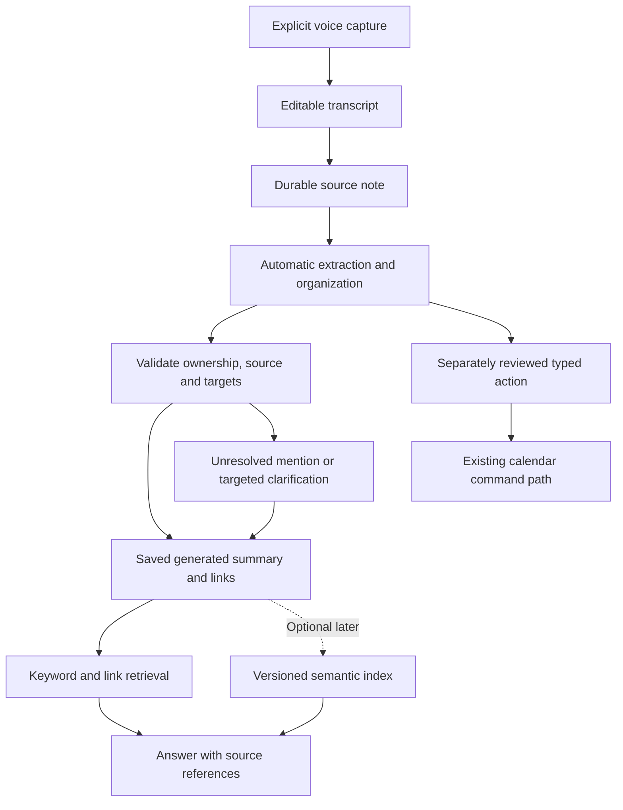

# Second Brain, Voice Capture and Knowledge Companion

**Updated:** 16 October 2026

**Status:** Product/architecture proposal for the user's Obsidian-inspired second brain and cute-monster voice companion. It extends [the personal AI direction](PERSONAL_AI_PLAN.md) and [personalization controls](PERSONALIZATION_PLAN.md). No notes store, embeddings, graph, avatar, importer, job or provider is implemented by this document. The user is exploring this concept; the precise pilot scope and mascot design remain proposals.

**Confirmed organization direction:** Users should not have to link or categorize each thought manually. Captured content triggers automatic organization and linking within disclosed processing scope. Routine organization requires no per-link approval; ask only when ambiguity matters, and keep calendar actions, authoritative facts/rules and external effects on their distinct permission paths. This clarification supersedes the earlier review-every-link proposal.

## 1. Product promise and technical corrections

Recommended promise: **Tell your companion what is on your mind; find it later and turn it into a plan you choose.** “Knowledge Dungeon” can be an optional playful name for the knowledge area. Keep plain labels such as Notes, People and Sources available.

Obsidian's official documentation describes Markdown files in a local vault with a rebuildable metadata cache. Linked notes provide a graph-like experience; this does not require a specialized graph database or embeddings. See [data storage](https://obsidian.md/help/data-storage) and [internal links](https://obsidian.md/help/links).

Three different mechanisms serve different purposes:

| Mechanism | Example | What it does not establish |
| --- | --- | --- |
| Explicit link | A note mentions the chosen Sarah record | That a second person called Sarah is the same person |
| Semantic retrieval | A cake note may be relevant to a birthday query | That Sarah likes that cake, or that the shop is still open |
| Typed operational fact | An accepted appointment starts at 15:00 in a specified zone | That a note mentioning “three tomorrow” is an accepted booking |

Embeddings measure textual relatedness and can improve retrieval; they are not proof, identity resolution or a replacement for links. The cake example needs correct attribution: the user's preference is not Sarah's preference. A response should explain why a note is relevant and ask about unknown preferences rather than inventing them. [Official embedding guidance](https://developers.openai.com/api/docs/guides/embeddings)

Keep PostgreSQL/Supabase for accepted schedules, owner isolation, typed People records and approved settings. Store note bodies as Markdown text in canonical note records, with metadata/links as defined below. Dexie holds supported local notes/intentions and confirmed snapshots. This is a web-app architecture inspired by portable Markdown, not a claim to reproduce Obsidian's desktop vault or Sync service.

## 2. Recommended first experience

Provide two explicit voice intents: **Talk to my assistant** and **Capture a note**. A conversational turn is not automatically a permanent knowledge entry. Starting capture clearly states that a text note will be saved and whether audio goes to a cloud transcription provider. Keep microphone controls and an editable text alternative.

For a capture such as “I liked the chocolate cake near Marcus's place. Ask Sarah what she wants for her birthday,” organize automatically and show a compact result:

- A saved source transcript with a visible correction action, after its own durable save.
- A generated clean summary/title, labeled as generated and editable, with the source wording preserved.
- Automatically attached topic and supported People/Place links; unresolved names remain provisional without blocking the note.
- An optional task/message draft, separate from the knowledge save.

Users can ignore the organization result and continue, or edit/unlink/correct it later. There is no required approval queue for summaries, categories or routine links. Explicit note capture authorizes preserving that captured text and the configured automatic organization; it does not approve every extracted fact as authoritative memory, planning rule or action. Keep automatic organization disclosed/configurable, with a plain source-only option. Do not require a confirmation for every ordinary note save when the intent is already clear.

Capture should be useful before embeddings, graph animation or an action integration succeeds. Saving a note does not award XP. A deliberately created and later completed quest follows existing reward rules; it is not duplicated for every extracted mention.



This is the intended flow, not a working durable queue. Save/import APIs, local stores and reconciliation still need implementation. Transcript recognition may be provisional; never execute a command from partial speech or an uncorrected ambiguous name/date.

### Automatic organization workflow

Run one bounded application workflow after an eligible capture is durably saved. This is a product processing pipeline, not a separate agent users must configure or an always-on monitoring service.

1. **Trigger:** The saved source ID/revision and the owner's organization settings identify the job. The workflow uses the allowed source/context only; opening a panel or ordinary conversation is not a capture trigger.
2. **Extract:** Produce schema-validated title, summary, topics, entity mentions, dates and candidate connections with source spans. Names/dates in notes remain reported content until a separate typed operation promotes them.
3. **Find candidates:** Query relevant existing People, notes, projects and approved aliases within the same account. Explicit target IDs and source context can support automatic resolution. A model's self-reported confidence or a name match alone is insufficient when identity is unclear.
4. **Apply routine organization:** Automatically save reversible, attributed generated summaries/topic groupings and validated mention links. New general topics can be created/deduplicated automatically; an unknown person's mention stays provisional rather than silently creating or merging an authoritative People profile.
5. **Handle uncertainty:** Preserve the note and unresolved mention. Ask a small question only when resolving it is needed for the current requested result, such as “Sarah from work or Sarah from university?” Otherwise leave it available for later clarification. Do not interrupt for every possible link.
6. **Persist and index:** Keep generated organization/link provenance separate from source wording and confirmed facts. Record source revision, target IDs, relationship kind and processing version. Index current eligible material; embeddings remain optional and do not block saving/organization.
7. **Report quietly:** Show “Organized” with an optional “View connections” or correction action. Distinguish saved locally, synced, organizing, needs clarification and failed. No success state may imply that unrun external actions succeeded.
8. **Retry and correct:** Deduplicate by owner/source/revision/workflow version; bounded retries cannot create duplicate topics/edges. Source edits/deletion fence late output. Unlinking or correcting a generated connection records the applicable rejection/correction so reprocessing does not immediately recreate it; a correction is source-scoped unless the user explicitly teaches a broader alias/rule.

Automatic links need explicit kinds: a source-backed `mentions` link means the captured text refers to that target; a machine-generated `related` link is a navigation suggestion, not an assertion that two people know each other or share a preference. Generated links show their origin and are removable. A user-authored link remains distinct from an automatically inferred one.

An example result is “Saved under Food; linked to the selected Marcus; Sarah needs clarification.” The user never has to write `[[Marcus]]`, choose folders or maintain backlinks. The app generates the graph/index and renders Markdown-compatible links when displaying/exporting the organized view, without rewriting the original transcript or overwriting user-authored edits.

Automatic processing starts after capture without a separate per-note AI button when the configured scope allows it. Use bounded foreground processing for the first slice. Durable server job execution after the browser closes needs its own queue/runner, authorization and retry design; the automatic workflow does not imply closed-app reminders or continuous surveillance.

## 3. Authority, representations and links

| Representation | Authority / writer | Lifecycle |
| --- | --- | --- |
| Captured text | User-owned source document, corrected through a versioned edit | Visible provenance; retention and deletion independent of raw audio |
| Organized Markdown note | User-authored accepted content or a separately labeled machine-generated projection of a saved source | Editable/exportable and revisioned; generated does not mean user-confirmed fact |
| People facts and planning preferences | Existing typed People/configuration concepts when confirmed | Notes link to them or show labeled projections; no second mutable birthday/rule store |
| User-authored explicit links | Parsed link tokens with stable account-scoped target IDs | Rebuildable index, with rename and unresolved-target handling |
| Automatically generated mention/topic links | Validated organizer output with source span/revision and resolved same-owner targets | Applied without routine approval; inspectable, removable and regenerated under correction rules |
| Suggested semantic relationships | Labeled derived navigation connections with evidence/version | May appear automatically as related material; never factual assertions or auto-merged identity |
| Search chunks/embeddings | Derived from eligible current source versions | Rebuildable; not authoritative memory; excluded after edit/forget/delete |
| Schedule/status/rewards | Canonical calendar domain and controlled commands | Referenced from notes; editing Markdown does not mutate an event |

Use stable UUIDs for documents, People and link targets; names are labels. Resolve “Sarah” automatically when supported by scoped identity/context, without requiring a manual link. Preserve unresolved mentions when unknown and clarify only when consequential to the current result. Creating/merging authoritative People records remains deliberate; do not create one from every name token or merge solely on embedding similarity.

The Markdown body owns ordinary note text. Explicit link occurrences can carry stable target IDs in the internal editor representation; the parsed link index is derived from the accepted document revision and must not become a second independently edited truth. Human-readable export paths/aliases are generated from a manifest. Renaming a person or note must not break internal identity or reassign old mentions to a different person.

Generated organization lives in a versioned derived layer with correction overrides, not a second canonical note body. Render its links into a generated view/export when requested, labeling its provenance. Editing the original note or choosing a generated summary as one's own note is a distinct operation; automatic processing cannot clobber either. Derived summaries can aid retrieval but factual answers must retain/recheck the underlying source, not cite generated prose as independent evidence.

Accepted note content may remain uncertain or subjective. Preserve who said what, when it was observed, the source and relevant review/expiry. A claim from a voice note is not verified knowledge about another person's current health, availability or preferences. Reusable structured facts/settings are promoted only through the explicit teaching/memory path.

## 4. Suggested person-note Markdown template

The following is a **proposed portable export representation**, not a current SQL schema or a command protocol. UUIDs are illustrative. The Markdown editor stores prose; birthday/favorite/boundary values, if promoted into typed records, are shown as labeled projections or references rather than independently editable duplicates. No real person is being profiled by this example.

```markdown
---
schema_version: 1
id: "30c87739-cbf2-4c9e-9339-f95aa2c13fab"
kind: person_note
title: "Sarah"
person_ref: "7f10846a-6c40-4d26-96a6-105b6481bf87"
revision: "1"
captured_on: "2026-10-16"
source_refs:
  - "810ae718-0a43-42f5-b44a-e765e7999200"
---

# Sarah

## What I want to remember
- User reported that Sarah mentioned an upcoming design project.
- Source: [[Inbox/810ae718-0a43-42f5-b44a-e765e7999200|Captured note]]

## Plans to consider
- Ask whether she wants to catch up after the project.
- This is an intention, not a booked event or scheduled reminder.

## Related notes
- [[Projects/92f8534a-91ac-4f12-924b-4a565652afaa|Design project]]

## Unknown or needs review
- Birthday: not provided.
- Favorite foods: not provided.
- Current availability: unknown.
```

For structured person metadata, propose optional month/day birthday with year only if supplied, explicitly attributed preferences, a preferred-contact note and optional last-contact information. Never fabricate a year or treat a last-contact note as an observed message log. Birthday recurrence needs an explicit timezone and leap-day policy before reminders ship.

Boundary rules need an identified subject: “I avoid weekday social plans” is the user's rule; “Sarah prefers no late calls” is a user-reported note about Sarah. Neither grants messaging authority. Link to the confirmed typed rule rather than embedding executable policy in frontmatter. Imported `owner_id`, permission, automation or provider settings are never trusted; the importer assigns authenticated ownership and validates allowed fields.

Wiki-links are an export option for Obsidian-oriented use; offer standard relative Markdown links for broader portability. A versioned manifest maps UUIDs to safe relative filenames and captures document revisions/link targets. This should let notes remain readable outside Gamecal while avoiding name collisions. Imported IDs are untrusted: default to fresh owner-scoped IDs and map links within the import batch, never overwrite existing records just because an ID matches.

## 5. Storage and browser boundaries

Recommended MVP: canonical Markdown text/metadata in Supabase PostgreSQL, account-scoped Dexie local saves and foreground sync, plus deliberate `.md`/archive export later in the notes slice. Small text notes do not require a binary object-storage service. Existing browser cache eviction/recovery contracts still apply; local browser storage is not a backup or a guaranteed cross-device vault.

Persistent access to arbitrary folders is not a cross-browser assumption. The File System API uses permissioned handles; origin-private storage is different from a folder the user can browse. A path string does not grant file access. See [MDN's File System API guidance](https://developer.mozilla.org/en-US/docs/Web/API/File_System_API).

Treat direct desktop-folder access as a later progressive enhancement with browser capability/permission checks, explicit access, revoked-access recovery and import/export fallback. No promise of automatic phone-folder synchronization, filesystem watching, browser-closed operation or direct Obsidian Sync compatibility. Direct folder mode would introduce a new external writer and needs a separate conflict/identity/recovery design before implementation.

Storing only an attachment path does not let the server transcribe, embed or retrieve its content. Indexing a user-selected file requires deliberate reading and disclosure of any provider transfer. Export/import is different from attaching a local reference. No arbitrary filesystem scan, remote URL fetch or upload of an entire vault is implied.

Notes, search chunks, vectors and replicas all have storage/compute costs. Local-first storage does not eliminate cloud synchronization or provider processing costs. Do not persist raw audio by default; source transcript retention is a distinct product choice. Files/audio, if later supported, need their own byte/type/retention and account deletion contracts.

## 6. Retrieval and embedding rollout

Begin with scoped keyword/title search, explicit links/backlinks and People/date filters. Retrieve only eligible owner content with bounded result/context size. Responses link to actual document/source revisions and state when nothing reliable is found. Important names and exact dates should not depend solely on semantic ranking.

If evaluation shows recall gaps, add semantic retrieval alongside keyword/graph filters. Supabase supports vectors through PostgreSQL/pgvector and documents hybrid keyword/semantic retrieval; it is the preferred candidate within our existing stack. There is no current reason to add Pinecone, Chroma, Neo4j or a second backend. [Vector columns](https://supabase.com/docs/guides/ai/vector-columns), [hybrid search](https://supabase.com/docs/guides/ai/hybrid-search).

`text-embedding-3-small` is an example candidate from the user's proposal, not a selected dependency/model. Record provider/model/version, dimensions, chunking version, source revision and content hash for every derived index. Model/dimension changes require a deliberate rebuild; do not mix incompatible embeddings in one query. Explain that semantic proximity is fallible and has no universal confidence threshold proving a fact.

Index eligible saved sources and accepted notes within the configured processing scope. Labeled generated summaries/links may be indexed as derived from those sources without per-item approval; retain the current source revision and fetch source evidence for answers. Temporary action drafts and unapproved reusable memories do not become authoritative memory through indexing. Build/update embeddings after the source save, not as a prerequisite to saving text. Until a bounded runner is designed, process eligible captures automatically in bounded foreground work and show pending/failed indexing honestly. AI processing may fail without losing the source capture.

Generation/index jobs must use idempotent source/version identities and compare current revision/hash before committing output. A delayed job cannot resurrect deleted text or index a superseded revision. Coalesce retries and bound tokens, chunk sizes, per-account work and shared provider spend. Full-text, link and vector projections need the same deletion/invalidation contract.

Authentication and owner filtering apply to every document/chunk/link/search result before model context assembly. Design and test RLS/private search functions without relying on a client-supplied owner filter or a broad service-role search followed by post-filtering. Join/recheck parent eligibility and source revisions; do not trust owner UUID fields generated by the model. Raw notes and embeddings must not enter public caches or ordinary logs.

Evaluate retrieval on correct-person selection, paraphrases, missing facts, contradictory/old notes, cross-account isolation, source citations and deleted/stale content. Measure wrong-person suggestions as well as recall. Keep example “cake near Marcus” tests explicit about whose preference it is and whether a current place name is actually known.

## 7. Rework the proposed workflows

| Proposed workflow | Recommended behavior | Delivery stage |
| --- | --- | --- |
| Voice dump about cancelling dinner and saving a film | Resolve the exact event and referenced note; show separate cancellation and watchlist proposals. Preserve unresolved film names instead of guessing | Bounded capture/retrieval first; calendar cancellation only when its actual command contract exists |
| Brief before meeting Jessica | On demand, show a private cited recap with source dates and uncertainty. Sensitive third-party material is excluded from unsolicited/spoken briefings by default | On-demand recap first; scheduled/push briefing separately gated |
| Protect Tuesday before a Wednesday presentation | Read the actual calendar, approved preferences and relevant source notes; propose a buffer/Thursday alternative for review | User-requested planning; no hidden cancellation or automatic negotiation |
| Another user's monster requests a time | Treat as untrusted external input; share only deliberately authorized availability or message content | Later sharing/federation design, not initial People scope |

“Cancel dinner” must not become an unreviewed hard delete. Product cancellation semantics, appointment versus quest status, event identity, revisions and any reward implications need a supported typed operation and visible review. A note that says “cancel this” is data, not a live command. Accepting a watchlist note does not also approve the calendar change; preserve separate results when one operation fails.

For a Jessica recap, a past note about a cat's surgery does not establish current status or permission to announce it aloud. Use dated attribution and private display; let the user choose what to ask. A lock-screen notification should be generic and omit private names/details by default. Do not share these notes with Jessica, another agent or an external model beyond the selected processing scope.

Proactive briefings need an explicit standing assignment, source coverage, timezone, quiet hours, privacy controls, backend scheduler/runner, budget/retry bounds and observable last-check/delivery state. They cannot rely on the foreground calendar outbox or a browser timer for closed-app delivery. Agent-to-agent planning additionally needs identities, authenticated consented channels, allowed shared fields and invitation/revocation protocols. No such infrastructure is implied by a graph or avatar.

## 8. Knowledge UX and companion

Keep the voice-led Today canvas from the personal-AI proposal. Suggested destinations are Today, Calendar, People and Knowledge. Knowledge opens an Inbox of captures, a searchable note list and related-note/source panels. A graph view is optional secondary exploration, with a list/backlink equivalent; a graph must not become a prerequisite for finding a note on a phone.

The cute monster is a presentation of the same personal assistant, with truthful idle/listening/transcribing/organizing/awaiting-review/saved/error states. It can celebrate an accepted organizational step briefly, with reduced-motion and mute controls. It cannot imply that an unsaved or unsynced note is safely stored. No guilt, hunger penalty or XP incentive for revealing more private information.

One lightweight 2D companion is a proposed starting treatment; optional 3D objects/room props can follow measured mobile performance. The earlier twin/single-companion choice remains a visual decision, not multiple independent authorities. Do not generate art, add a renderer or replace the existing UI in this planning pass.

## 9. Minimal delivery sequence and proof

1. Keep the previously reviewed calendar read/validation fixes and verified Auth/durable local persistence prerequisites. Define one bounded source/note/link model with exact owner/revision/deletion/RLS/API contracts before migrations.
2. Build explicit voice/text note capture, editable source, automatic bounded organization and clear save/sync status. Reuse the voice adapter evaluation; do not choose transcription models solely because an older example names them.
3. Add automatic supported People/topic links, selective ambiguity clarification, simple retrieval and a cited answer/recap. Support correction/unlinking, forgetting and portable Markdown export with stable IDs and safe filenames. Export availability is not proof that imports can restore an account or queued work.
4. Offer one separately reviewed calendar/task proposal from retrieved context once its timed/status command is supported. Demonstrate partial failures without losing notes or implying unsupported writes succeeded.
5. Evaluate hybrid semantic retrieval against the simpler baseline when needed. A bounded synthetic-data Mem0 comparison may happen earlier, before investing in a broad custom memory engine; it does not require adopting a service. Later validate a graph view, Markdown import/folder integration, proactive briefing and agent-to-agent capabilities independently.

Acceptance examples: voice transcription error in a name/date; two Sarahs; unknown film; note retention versus ordinary chat; lost network during capture; rejected AI summary; stale index after edit/delete; cross-account vector/link queries; hallucinated citation; transcript correction after derived facts; safe Markdown rendering; exported link collisions; source deletion during generation; conflicting imports when supported; sensitive recap spoken aloud; and multi-intent partial success. Add tests with implemented behavior, not speculative unused infrastructure.

Automatic-organization acceptance also requires: a normal capture gains useful links without any manual linking or approval click; unclear identity does not silently bind; clarification is deferred when nonessential; repeated processing creates no duplicate edges; corrections/unlinks survive reprocessing; and generated summaries never overwrite user-authored content or acquire fact/action authority. Measure manual steps avoided, correct-link rate and unwanted interruption rate rather than number of edges created.

Treat Markdown as untrusted content: allowlist link destinations, escape/sanitize rendering, disable executable HTML/scripts and automatic remote embeds, and never execute frontmatter or imported note instructions. Exports exclude credentials, provider tokens, grants and private app configuration; private user notes themselves are explicitly disclosed export content, unlike public persona templates.

Finalize source/summary retention, promotion into approved memory, exact first document/link types, import/export compatibility boundaries, reference browser/languages, voice duration limits and retrieval quality/cost targets before implementation. Keep explicit note capture separate from wholesale file ingestion, passive observation and public sharing.

## 10. Provider research notes

As reviewed on 16 October 2026, OpenAI's file-transcription guide says `whisper-1` does not support streamed transcript responses. A cloud transcription endpoint is also distinct from low-latency live conversational audio. The provider's deprecation page lists `whisper-1` for removal on 26 February 2027; do not pin it as the new app's default from this concept. No replacement model or provider is selected here. [Transcription guide](https://developers.openai.com/api/docs/guides/speech-to-text), [deprecations](https://developers.openai.com/api/docs/deprecations).

Deepgram Nova-2 was supplied as an example; its current suitability, languages, lifecycle, browser streaming and terms have not been evaluated in this pass. A provider comparison should use current official sources and actual target-browser trials before selection. `text-embedding-3-small` remains an embedding candidate only. No price, latency guarantee, provider retention policy or end-to-end encryption claim is adopted from these examples.

The official sources establish storage/search/API capabilities, not that a Knowledge Dungeon increases growth or improves relationships. Test successful capture, source-supported recall, correction/forgetting effort, useful chosen plans and avoided wrong-person disclosure. Speaking longer, collecting more facts or producing a dense graph is not evidence of user benefit.

## 11. Mem0 evaluation: optional memory engine

**Recommendation:** Mem0 is not a prerequisite for the MVP, but it is a credible build-versus-buy candidate. Evaluate a small representative slice before building a general memory platform ourselves. Research alone does not select Mem0, create an account, install its SDK or authorize transferring user data.

Mem0's [managed quickstart](https://docs.mem0.ai/platform/quickstart) documents extracting memories from supplied conversations and searching them. Its current [managed Graph Memory](https://docs.mem0.ai/platform/features/graph-memory) automatically connects memories through extracted entities and uses those connections in retrieval. It does not supply our domain-specific typed relationships or resolve the meaning of our People IDs. This overlaps the automatic organization/recall requirement, not the entire application.

The [open-source overview](https://docs.mem0.ai/open-source/overview) describes library and self-hosted server options, configurable storage/model components and a PostgreSQL/pgvector server default. Mem0 therefore does not inherently require a second hosted database/provider. Exact Node.js/runtime, storage, history and isolation integration still need testing; do not assume open-source and managed graph features or legacy examples have identical behavior.

| Option | Potential fit | Work/cost to prove |
| --- | --- | --- |
| Narrow application-owned workflow on Supabase | One source of record with our exact note/rule/correction model | Implement and evaluate bounded extraction, linking and retrieval; avoid building a generic platform |
| Managed Mem0 behind a server adapter | Candidate for faster memory extraction/linking/recall | Additional processor and service dependency; validate behavior, cost, data lifecycle and integration |
| Open-source Mem0 with configured storage | Candidate for engine reuse with infrastructure control | Operate/configure durable stores, models, tenancy and lifecycle; package availability is not zero operating cost |

Keep canonical schedules, source notes, approved preferences, action grants and domain identity in Supabase. A chosen memory engine would be a derived extraction/retrieval layer with stable mappings to canonical source IDs/revisions. It must not become an independent authority that silently changes People facts or permissions. Do not dual-write and hope both stores agree: define source-first processing, retry receipts, idempotency and invalidation before integration.

Run a bounded comparison using synthetic notes: two Sarahs; a paraphrased food query; whose preference a note describes; an updated/corrected fact; a removed link; a deleted source; duplicate add/retry; and isolated accounts. Compare useful recall, wrong-person errors, citation/source fidelity, ability to preserve unlink/correction overrides, latency, provider/model/storage cost and implementation effort against a narrow native baseline. Vendor benchmark gains are not Gamecal measurements.

The adapter must derive user scope from verified server identity, restrict allowed source content and validate output. A Mem0 `user_id` filter alone is not our authentication/RLS proof. Prove source correction/deletion propagation, exclusion of stale/rejected memories, version-aware retries, export and service-outage fallback. Inspect actual retention/history/backups and current terms before real user data is sent. Extraction from allowed captures is not permission to retain every conversation or promote inferred facts into approved memory.

Adopt only if the comparison shows a material speed/quality benefit and the lifecycle requirements are achievable. Managed recall may still be usable without exposing a raw graph to our UI; verify actual API support before promising inspectable/editable graph edges. Avoid speculative adapter frameworks now: preserve a small application boundary around extraction/retrieval when implementing the first slice. The decision remains open; no Mem0 dependency or integration is added in this planning pass.
